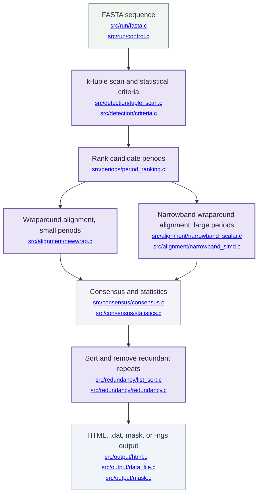

<div align="center">

# NuTRF

**NuTRF is an exact-output, faster build of Tandem Repeats Finder (TRF), a program that locates tandem repeats in DNA sequences.**
<a id="contents"></a>

<p align="center">
  <a href="#quick-start">Quick start</a> &nbsp;·&nbsp;
  <a href="#usage-and-parameters">Usage</a> &nbsp;·&nbsp;
  <a href="#implementation-status-and-roadmap">Implementation Status and Roadmap</a> &nbsp;·&nbsp;
  <a href="#benchmarks">Benchmarks</a>
  <br>
  <a href="#ai-use-and-review">AI use and review</a> &nbsp;·&nbsp;
  <a href="#questions-and-contributions">Questions and contributions</a> &nbsp;·&nbsp;
  <a href="#acknowledgments-and-references">References</a>
</p>

</div>

---

NuTRF builds on [Tandem Repeats Finder 4.10.0](https://github.com/Benson-Genomics-Lab/TRF) (upstream commit `355c1f9`). It keeps TRF's command line, detection model, and output formats, and reduces the time spent in period ranking and wraparound alignment. On the tested inputs its output files, standard output, standard error, and exit status match the original byte for byte.

> [!IMPORTANT]
> The executable is still named **`trf`** and takes the **same arguments** as TRF 4.10.0. The fastest paths need an **x86-64 CPU with AVX2**; other CPUs run the same code through slower fallbacks with identical output.

<a id="quick-start"></a>

## Quick start <sup><sub>[↑ Contents](#contents)</sub></sup>

<a id="1-build"></a>

### 1. Build <sup><sub>[↑ Contents](#contents)</sub></sup>

Requires a **C compiler** (GCC or Clang) and **CMake 3.16+**. **Python 3.10+** is needed only for the tests.

```sh
git clone https://github.com/BioCode-Commons/NuTRF.git
cd NuTRF

cmake -S . -B build/release -DCMAKE_BUILD_TYPE=Release
cmake --build build/release -j 8
ctest --test-dir build/release --output-on-failure   # optional
```

The executable is `build/release/trf`.

<details>
<summary><strong>Build configuration</strong></summary>

| CMake option | Default | Use |
| :--- | :--- | :--- |
| `CMAKE_BUILD_TYPE` | `Release` | Build type |
| `TRF_RELEASE_FLAGS` | `-O2 -g` | Compiler flags of the Release build |
| `TRF_UNITY_BUILD` | `ON` | Compile each module directory as one translation unit, so that calls between its source files are inlined |
| `TRF_ENABLE_RELEASE_IPO` | `OFF` | Link-time optimization across all modules |
| `TRF_ORACLE_DIR` | `build/oracle` | Location of the original TRF used by the differential tests |
| `TRF_TEST_LARGE_FIXTURE` | `OFF` | Also test a 10 Mb repeat array with `-l10`; needs about 6 GB of memory |

The build always adds TRF's own `-fno-align-functions -fno-align-loops`. Do not raise the optimization level or add fast-math or `-march` flags if you need output identical to the original: identity was verified with `-O2` only. SSE4.1 and AVX2 code is compiled per function and selected at run time, so no architecture flag is needed.

To install, run `cmake --install build/release --prefix <dir>`. This installs `bin/trf` and, as the original TRF does, a link named after the version and platform, such as `trf4.10.0.linux64.exe`.

`ctest` runs the tests that need only this build and reports the differential tests as skipped until the original TRF is available. To run them as well, build the original once from the repository history with [tools/oracle/build_original_trf.sh](tools/oracle/build_original_trf.sh) and run `ctest` again; see [CODE_STRUCTURE.md](CODE_STRUCTURE.md#tests).

</details>

<a id="2-run-the-bundled-example"></a>

### 2. Run the bundled example <sup><sub>[↑ Contents](#contents)</sub></sup>

```sh
build/release/trf tests/fixtures/small_test.fasta 2 5 7 80 10 50 2000 -h -ngs > small_test.out
cmp small_test.out tests/fixtures/small_test.fasta.out && echo "output matches"
```

<a id="3-analyze-a-genome"></a>

### 3. Analyze a genome <sup><sub>[↑ Contents](#contents)</sub></sup>

```sh
trf genome.fa 2 7 7 80 10 50 500 -h -ngs -l 6 > genome.trf.txt
```

`-h` suppresses HTML, `-ngs` writes the compact table to standard output, and `-l 6` allows repeat arrays up to 6 Mb, which the original TRF recommends for human assemblies. Each sequence is processed on one thread; to use several cores, split the FASTA by sequence and run one process per file.

<a id="usage-and-parameters"></a>

## Usage and parameters <sup><sub>[↑ Contents](#contents)</sub></sup>

<details>
<summary><strong>Command line, outputs, and parameter reference</strong></summary>

```text
trf File Match Mismatch Delta PM PI Minscore MaxPeriod [options]
```

All weights, penalties, and scores are given as positive numbers.

| Argument | Meaning |
| :--- | :--- |
| `File` | FASTA input; several sequences per file are allowed. With `-ngs`, `-` reads standard input |
| `Match`, `Mismatch`, `Delta` | Match weight, mismatch penalty, and indel penalty for wraparound alignment. `2 7 7` and `2 5 7` are common choices |
| `PM`, `PI` | Match and indel probabilities as whole numbers. Statistical tables exist for `PM` 80 or 75 and `PI` 10 or 20; `80 10` is fastest |
| `Minscore` | Minimum alignment score to report a repeat |
| `MaxPeriod` | Largest period size to report, up to 2000 |

| Option | Use |
| :--- | :--- |
| `-m` | Write a masked sequence file with repeats replaced by `N` |
| `-f` | Record 500 bases of flanking sequence in the alignment file |
| `-d` | Write a `.dat` data file |
| `-h` | Suppress HTML output; turns `-d` on |
| `-r` | Disable redundancy elimination |
| `-l <n>` | Longest expected repeat array in millions of bases; default 2. Higher values need more memory |
| `-ngs` | Compact data output on standard output, with 50-base flanks and `@header` lines; exit status 0 on success |
| `-u`, `-v` | Print usage or version |

### Outputs

| Output | Contents |
| :--- | :--- |
| `<file>.<params>.<n>.html` | Repeat table: indices, period size, copy number, consensus size, percent matches and indels, score, base composition, entropy |
| `<file>.<params>.<n>.txt.html` | Alignment of each repeat against its consensus |
| `<file>.<params>.summary.html` | Index page for multi-sequence input |
| `<file>.<params>.dat` | The repeat table as plain text, plus consensus and repeat sequence (`-d`) |
| `<file>.<params>.mask` | Masked FASTA (`-m`) |
| Standard output | Compact table (`-ngs`) |

### Compatibility

NuTRF does not add, remove, or rename options, and it keeps the original's parsing quirks and messages. Inputs with an array longer than the `-l` limit are slow in the original and remain slow here; see the [roadmap](#roadmap).

The original manual, including the table and alignment explanations and the description of the detection model, is kept in [docs/TRF_README.md](docs/TRF_README.md).

</details>

<a id="implementation-status-and-roadmap"></a>

## Implementation Status and Roadmap <sup><sub>[↑ Contents](#contents)</sub></sup>

NuTRF retains TRF's detection, alignment scoring, statistics, and redundancy rules. The changes replace how four inner computations are carried out, not what they compute. The flow below shows where they sit; shaded boxes are the stages NuTRF changes.



| Stage | Status | What changed |
| :--- | :--- | :--- |
| Period ranking | Optimized | Bucketed positions with a moving lower bound; AVX2 byte-compare histogram for long patterns |
| Narrowband alignment | Optimized | Branch-light scalar kernel; SSE4.1 and AVX2 row kernels chosen at run time |
| Small-period alignment | Optimized | Second circular pass reuses the first; AVX2 rows |
| k-tuple scan | Optimized | Division-free ring indices and tuple codes; table lookup for the base test |
| Redundancy elimination | Optimized | Stable merge sort in place of bubble sorts |
| Detection model, scoring, statistics, output | Unchanged | Same code paths and formats as TRF 4.10.0 |
| Multithreading | Not implemented | One thread per process, as in the original |

### Inside NuTRF

- **Period ranking:** [period_ranking.c](src/periods/period_ranking.c) counts distances between equal dinucleotides. Positions are grouped into sixteen buckets and only predecessors inside the 6,000-base window are visited. On AVX2 hosts, patterns of at least 128 bases compare a byte array of dinucleotide codes with itself at every shift. Counts are integers converted to double once, so the regression input is unchanged.
- **Narrowband alignment:** [narrowband_simd.c](src/alignment/narrowband_simd.c) evaluates the left-gap recurrence as a prefix maximum, so each block of cells carries one dependency instead of one per cell. Consecutive ordinary rows run in dedicated AVX2 loops; any other row returns to the general loop. A per-row range check keeps these kernels active for large `-l` values.
- **Small-period alignment:** [newwrap.c](src/alignment/newwrap.c) uses the closed form of the second circular pass, turning each row into one prefix maximum.
- **Fallbacks:** every vector path has a scalar path with the same results, selected at run time by CPU feature or at compile time with `-DTRF_NARROWBAND_DISABLE_AVX2`, `-DTRF_NARROWBAND_DISABLE_RAMP`, `-DTRF_NEWWRAP_DISABLE_SIMD`, and `-DTRF_PERIODS_DISABLE_SIMD`.
- **Verification:** [tools/oracle/build_original_trf.sh](tools/oracle/build_original_trf.sh) builds the original TRF from the repository history. [tests/integration/exact_check.py](tests/integration/exact_check.py) then runs both programs on the same inputs and compares exit status, both output streams, the file list, and every byte of every file. The kernel tests in [tests/unit/](tests/unit/) compare complete alignment matrices and histograms with the original functions.

See [CODE_STRUCTURE.md](CODE_STRUCTURE.md) for a guide to the source, the properties each kernel preserves, and the tests.

<a id="roadmap"></a>

### Roadmap <sup><sub>[↑ Contents](#contents)</sub></sup>

- [ ] Arrays longer than the `-l` limit. Human chr1 with the default 2 Mb limit did not finish within two hours in the original, and NuTRF does not change the cost of that case.
- [ ] Parallel processing of independent sequences within one process.
- [ ] Vector kernels for non-x86 CPUs (NEON), which currently use the scalar paths.
- [ ] Remove the signed-overflow dependence inherited from the original period regression, so that identity no longer rests on compiler behavior.
- [ ] Extend output-equivalence checks to more genomes, parameter sets, compilers, and operating systems.
- [ ] Complete the human code audit.

| Area | Next work | Check |
| :--- | :--- | :--- |
| Narrowband alignment | Reduce the vector-instruction count per row, which limits its speed | Complete-matrix comparison with the original function |
| Whole-genome runs | Benchmark a full human assembly and non-human genomes | Byte comparison of all outputs |
| Build | Test Clang, macOS, and Windows (Cygwin/MinGW) builds | `ctest` with the original TRF available on each |

<a id="benchmarks"></a>

## Benchmarks <sup><sub>[↑ Contents](#contents)</sub></sup>

We compared the original TRF and NuTRF on **whole GRCh38 chromosomes**, one core per run, both built with GCC 15.2.0 and the same flags.

| Input | Arguments | Original TRF | NuTRF | Speedup | Output |
| :--- | :--- | ---: | ---: | ---: | :--- |
| chr21 | `2 5 7 80 10 50 2000 -h -ngs` | 194.2 s | 34.5 s | **5.63×** | Identical |
| chr21 | `2 7 7 80 10 50 500 -h -ngs` | 109.4 s | 24.2 s | **4.52×** | Identical |
| chr20 | `2 5 7 80 10 50 2000 -h -ngs` | 858.7 s | 138.1 s | **6.22×** | Identical |
| chr20 | `2 7 7 80 10 50 500 -h -ngs` | 451.1 s | 79.9 s | **5.65×** | Identical |
| chr20 | `2 5 7 80 10 50 2000 -l 6 -h -ngs` | 315.8 s | 57.9 s | **5.45×** | Identical |
| chr1 | `2 5 7 80 10 50 2000 -l 6 -h -ngs` | 630.8 s | 144.9 s | **4.35×** | Identical |

Times are the median wall time of three runs. Peak memory is unchanged. **Output identical** means standard output or the `.dat` file, standard error, exit status, and the list of files matched the original byte for byte in every run. See [benchmark details](BENCHMARKS.md) for the setup, all configurations, memory, and limits.

<a id="ai-use-and-review"></a>

## AI use and review <sup><sub>[↑ Contents](#contents)</sub></sup>

| Item | Status |
| :--- | :--- |
| AI use | Assisted refactoring, optimization, tests, and documentation |
| Comprehensive human audit | Pending |

<a id="questions-and-contributions"></a>

## Questions and contributions <sup><sub>[↑ Contents](#contents)</sub></sup>

Visit [BioCode Commons](https://biocode-commons.github.io/) for projects, contribution guidance, and contact information.

<a id="acknowledgments-and-references"></a>

## Acknowledgments and references <sup><sub>[↑ Contents](#contents)</sub></sup>

Tandem Repeats Finder was developed by Gary Benson, with Yozen Hernandez, Yevgeniy Gelfand, and Alfredo Rodriguez. NuTRF builds on their [original source code](https://github.com/Benson-Genomics-Lab/TRF). Please cite the original work:

- [Tandem repeats finder: a program to analyze DNA sequences](https://doi.org/10.1093/nar/27.2.573). Benson, *Nucleic Acids Research*, 1999.

<details>
<summary><strong>BibTeX references</strong></summary>

```bibtex
@article{Benson1999TRF,
  author  = {Benson, Gary},
  title   = {Tandem repeats finder: a program to analyze {DNA} sequences},
  journal = {Nucleic Acids Research},
  year    = {1999},
  volume  = {27},
  number  = {2},
  pages   = {573--580},
  doi     = {10.1093/nar/27.2.573}
}
```

</details>

Licensed under the [GNU Affero General Public License v3 or later](COPYING), the license of the original TRF. Upstream authorship is recorded in [AUTHORS](AUTHORS); the original manual is in [docs/TRF_README.md](docs/TRF_README.md), and the original release notes are in [docs/upstream/](docs/upstream/).
